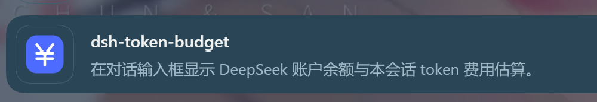

# dsh-token-budget-pill

[](./LICENSE)


在 **DeepSeek Harness** 对话输入框下方显示 **DeepSeek 账户剩余余额** 和 **本会话 token 费用估算**，让你随时知道「还剩多少钱、这轮对话花了多少」。

> 纯 DSH 客户端插件：不改 DSH 源码、不启独立服务、不写会话、不发模型请求。




## 它显示什么

输入框下方的统计条会多出一个 `¥` 胶囊：

```text
[¥] ¥56.68 · 本会话 ¥6.43
```

- **左边**：DeepSeek 账户当前可用余额（充值余额 + 赠送余额，二者相加）
- **右边**：本会话 token 的估算费用（按当前模型与当前峰谷时段计价）
- **点击**：展开明细面板

明细面板包含：

- 可用余额、充值余额、赠送余额（支持 CNY / USD 钱包）
- 本会话估算费用 + 占「起始额度」的百分比进度条
- 按本会话平均花费估算的「约可再用 N 轮 / X tokens」
- Token 明细：缓存命中输入、缓存未命中输入、缓存写入、输出
- 费用明细：缓存命中、缓存未命中、输出，以及缓存命中节省
- 手动刷新按钮 + 最近更新时间

## 安装

### 方式一：从 GitHub 安装（当前可用）

```bash
# dsh web（Web profile）
dsh plugin --profile web add github:gutddts/dsh-token-budget-pill && dsh web

# DSH Desktop（桌面版 profile）
dsh plugin --profile desktop add github:gutddts/dsh-token-budget-pill
```

如果安装器没有可用的 Git，也可以直接用 tarball：

```bash
dsh plugin --profile web add https://github.com/gutddts/dsh-token-budget-pill/archive/refs/heads/main.tar.gz
```

### 方式二：插件管理页

打开 **设置 → 插件 → 安装插件**，输入：

```text
github:gutddts/dsh-token-budget-pill
```

安装后刷新对话页（或重启 DSH）即可。

> 插件通过 `conversation.composer.dock` 插槽挂在输入框统计条里，所以需要进入一个**已有对话的会话**才看得到；新会话欢迎页的输入框是 hero 模式，不渲染这个 dock。

## 使用

1. 进入任意一个已有消息的会话。
2. 看输入框下方的统计条：`[¥] 余额 · 本会话费用`。
3. 点击胶囊展开明细；点右上角「刷新」立即重新读取余额。

余额会在页面可见时每 90 秒自动刷新一次；每轮对话结束后约 4 秒也会自动刷新。刷新失败时保留上一次成功的数字，并标注「显示上次结果」。

## 数据来源与隐私

| 数据 | 来源 |
|---|---|
| 账户余额 | DSH 账号 Remote `ctx.remote.account.getBalance()` |
| Token 用量 | Session 投影 `tokenUsage` |
| 轮次数 | Session 投影 `sessionStats` |
| 当前模型 | Session 投影 `modelSelection` |
| 价格 | 插件内置的 DeepSeek 官方价目表 |

- 凭证不进入页面：余额查询由 DSH 宿主侧完成，浏览器只拿金额快照。
- 不写 Session、不发模型请求、不向第三方上报任何数据。
- 唯一写入的是页面里的一个 `<style>` 标签（插件样式）。

## 计价口径

插件按 DeepSeek 官方价目表估算，自动识别 `deepseek-flash` / `deepseek-v4-pro`，并区分高峰 / 空闲时段。

| 模型 | 缓存命中输入（空闲 / 高峰） | 缓存未命中输入（空闲 / 高峰） | 输出（空闲 / 高峰） |
|---|---|---|---|
| `deepseek-flash` | ¥0.02 / ¥0.04 | ¥1 / ¥2 | ¥4 / ¥8 |
| `deepseek-v4-pro` | ¥0.15 / ¥0.30 | ¥4.5 / ¥9 | ¥13.5 / ¥27 |

> 高峰时段为北京时间周一至周五 09:00–12:00、14:00–18:00（周末与法定节假日为空闲）。插件按**当前时段**给整段会话计价，节假日未单独识别，因此「本会话估算」仅作参照；实际扣费以 DeepSeek 平台账单为准。

## 兼容性

- 需要 DSH `0.2.x`，并包含 `conversation.composer.dock` 插槽与账号 Remote。
- 已在 DSH Desktop `0.2.1-rc.2` 上实测：
  - 账户余额读取正常（充值 + 赠送）
  - `deepseek-flash` / `deepseek-v4-pro` 峰谷价估算正常
  - 输入框统计条与明细面板正常
- 未登录 DeepSeek 账号（例如只用 API Key）时，余额区域会提示不可用；本会话 token 与费用估算仍然可用。

## 开发

```bash
git clone https://github.com/gutddts/dsh-token-budget-pill.git
cd dsh-token-budget-pill
dsh plugin --profile web add link:$PWD
dsh web
```

### 目录

```text
lib/index.js      Host 半侧（空实现，让 Loader 暴露 client bundle）
lib/client.js     浏览器 bundle：余额 store、费用估算、胶囊与明细面板
cordis.patch.yml  bundle patch
icon.svg          插件图标
docs/screenshots  截图
```

### 发布到 npm

```bash
npm version patch
npm publish
```

## License

[MIT](./LICENSE)
